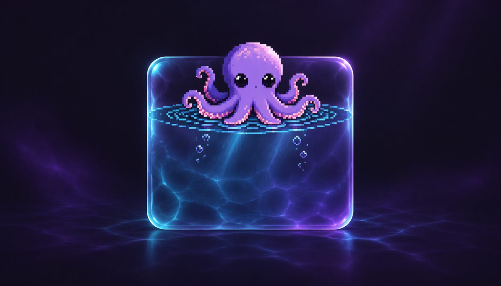

# Octo-Buzz

Ekranın üst-ortasında duran, fareni takip eden pixel-art ahtapot. Tauri + WebView ile
yazılmış, masaüstünde transparan ve tıklamaları geçiren bir katman olarak çalışır.

## Ne yapıyor?

- **Fareyi takip eder.** Göz bebekleri imlecin olduğu yöne bakar, 8 dokunaç yavaşça
  salınır ve imlece doğru uzanır; gövde panel içinde hafifçe sağa sola kayar.
- **Üst-orta panel.** 480×208 px, yuvarlak köşeli liquid-glass / su temalı kutu; içinde
  sağ üstte ayar dişlisi var. Altında yazı veya yoğun bir içerik fark ederse bir
  dokunaçıyla kenarından tutup kendini sağa veya sola çeker; imleç kutunun üstüne
  gelince durur, içerik açılınca merkeze geri döner.
- **Ctrl+Q (basılı tut).** En yakın dokunaç kutudan çıkıp fareye uzanır; basılı tuttuğun
  sürece fareyi canlı takip eder, bıraktığın anda geri çekilir.
- **Kanca.** Fare 560 px'ten uzaktaysa kolun ucundan halatlı bir kanca fırlar ve
  farenin olduğu noktaya gider — böylece ekranın tamamına erişebilir.
- **Küçük ruh hali.** İmleç yakına gelince ağzı açılır, ara sıra göz kırpar, baloncuk
  çıkarır; panel içinde nefes alır gibi sallanır.
- **Ayar sidebar'ı.** Dişliye tıklayınca soldan kayar: General, Features, API, Appearance
  bölümleri ve altta ortalanmış Instagram / GitHub / Web ikonları. GitHub ikonu bu
  depoyu açar; diğerleri şimdilik "Coming Soon".
- **API bölümü.** Gemini, Claude, OpenRouter ve NVIDIA NIM için anahtar kaydetme /
  silme, aktif sağlayıcı ve model seçimi, tek tuşla bağlantı testi (gecikme ms olarak
  görünür) ve sağlayıcının kendi model listesini çekme. Anahtarlar **Windows kimlik
  deposunda** (`keyring`) durur; diske ve webview katmanına yazılmaz, ekranda yalnızca
  son dört karakteri görünür.
- **Sohbet dock'u (sağda, her zaman açık).** Mesaj yazınca ahtapot seçili modelle
  konuşur; cevap hem dock'taki balonlarda hem de panelin altında bir **konuşma balonu**
  olarak görünür (beklerken üç nokta). Sol kenarındaki tutamacı sürükleyerek
  genişletilir/küçültülür, çift tıklayınca dar/geniş arasında atlar, boyut hatırlanır.
  Dock'un altındaki gönderme kutusu; temizle, aktif sağlayıcı + model etiketi ve
  gönder düğmesi içerir — etikete tıklayınca API ayarları açılır.
- **Sistem tepsisi.** Göster / Gizle ve Çıkış.

## Kurulum

Gereksinimler: Windows 10/11, [WebView2 Runtime](https://developer.microsoft.com/microsoft-edge/webview2/)
(Windows 11'de gelir), Node 18+, Rust 1.80+.

```bash
npm install
npm run tauri dev      # geliştirme: pencere anında açılır
npm run tauri build    # üretim derlemesi (src-tauri/target/release)
```

Uygulamayı kapatmak için sistem tepsisindeki ahtapot simgesi → **Çıkış**.

### İkonlar

`assets/icon.png` bağımlılıksız bir Node betiğiyle üretilir, ardından tüm platform
ikonları türetilir:

```bash
node tools/make-icon.mjs
npx tauri icon assets/icon.png
```

`assets/readme-banner.jpg` yalnızca README kapak görselidir, uygulamanın ekran görüntüsü değildir.

## Proje yapısı

```
src/
  main.ts      pencere düzeni, tıklama/sıcak bölge yönetimi, çizim sırası
  octopus.ts   pixel-art ahtapot: sprite, dokunaç fiziği, kol uzatma + kanca
  box.ts       üst-ortadaki panel ve ayar dişlisi
  settings.ts  sidebar içeriği, API bölümü ve komut çağrıları
  dock.ts      sağdaki sohbet dock'u: boyutlandırma, geçmiş, gönderme
  style.css    sidebar ve genel stiller
src-tauri/
  src/lib.rs   pencere/tepsi, global kısayol, imleç yoklaması, sıcak bölge anahtarı
  src/api.rs   sağlayıcı listesi, keyring, bağlantı testi ve model listesi
  icons/       üretilmiş uygulama ikonları
tools/
  make-icon.mjs bağımlılıksız PNG ikon üretici
```

## Nasıl çalışıyor?

Pencere tam ekran, transparan, daima-üstte ve **tıklama geçiren** durumda. Rust tarafı
16 ms'de bir global imleç konumunu okuyup webview'e gönderiyor; böylece ahtapot,
pencere odak olmasa bile fareyi görebiliyor. Ayar dişlisi ve açık sidebar için
`set_ignore_cursor_events` anlık olarak kapatılıp açılıyor — yani ekranın geri kalanı
her zaman masaüstüne geçirmeye devam ediyor.

Ahtapot 96 px'lik düşük çözünürlüklü bir sprite'a çizilip yumuşatma kapalı
yakınlaştırılıyor; bu yüzden kenarlar pixel-art gibi duruyor.

Panelin altındaki içerik `xcap` ile ekran görüntüsü alınıp kenar (luma gradyan)
yoğunluğu ölçülerek bulunuyor; ölçüm panelin altındaki ve kaçabileceği iki yandaki
bantlar için ayrı ayrı yapılıyor, böylece hangi tarafın daha boş olduğu anlaşılıyor.

API anahtarları `keyring` ile Windows kimlik deposuna yazılıyor (hizmet adı
`com.emmgg.octo`, kullanıcı adı `api-key:<sağlayıcı>`). Hangi sağlayıcının aktif
olduğu ve provider başına model seçimi ise `app_config_dir()/api.json` içinde,
anahtar içermeyecek şekilde duruyor. Bağlantı testi her sağlayıcının ucuz ve
kimlik doğrulayan ucuna gidiyor: Gemini `GET /v1beta/models`, Claude `GET /v1/models`,
OpenRouter `GET /api/v1/key`, NVIDIA ise `max_tokens: 1` ile küçük bir
chat isteği.

## Bilinen sınırlar

- yalnızca birincil monitörde çalışır
- çalıştığı sürece **Ctrl+Q** sistem genelinde bu uygulama tarafından yakalanır
- dock ve sidebar kalıcı sıcak bölge olduğu için o dikdörtgenler masaüstüne
  geçirmiyor; ekranın geri kalanı her zaman geçirmeye devam ediyor
- cevaplar tek seferde geliyor (token token akıtma yok), sohbet geçmişi pencere
  kapanınca sıfırlanır
- General / Features / Appearance bölümleri henüz yer tutucu
- lisans henüz belirlenmedi
